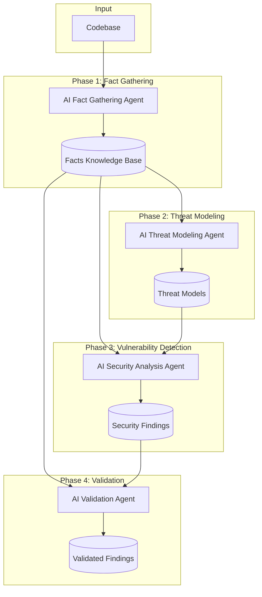
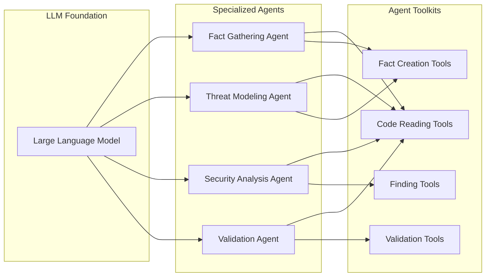
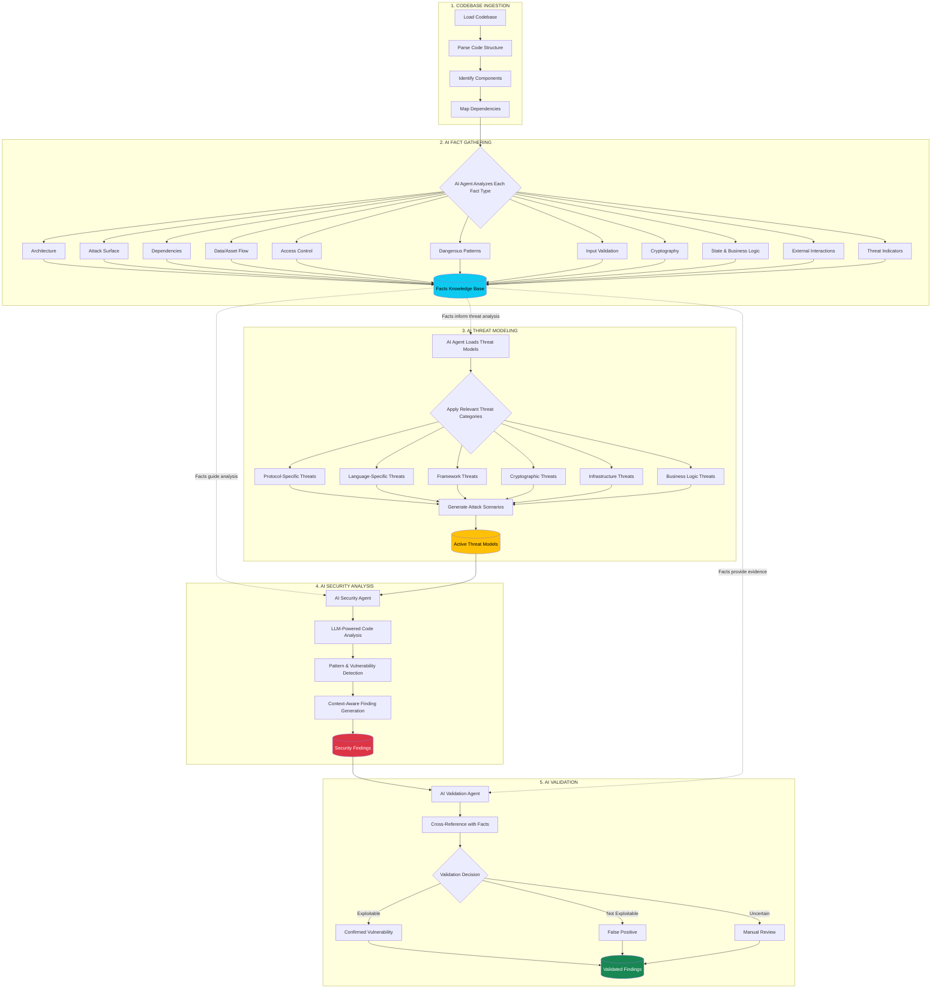
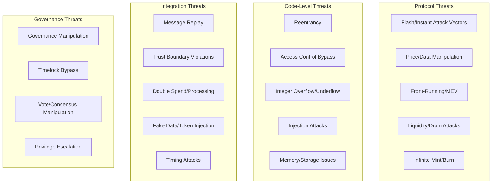
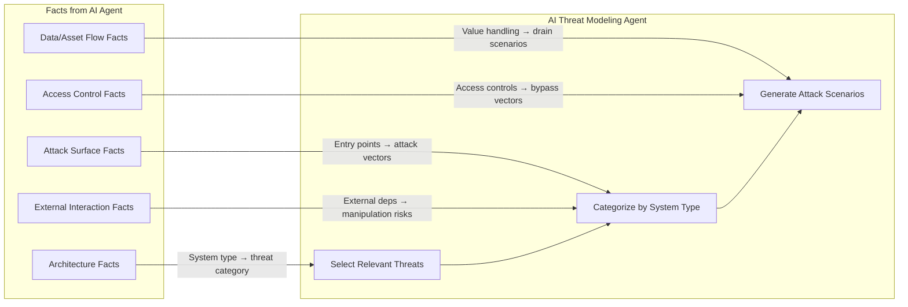
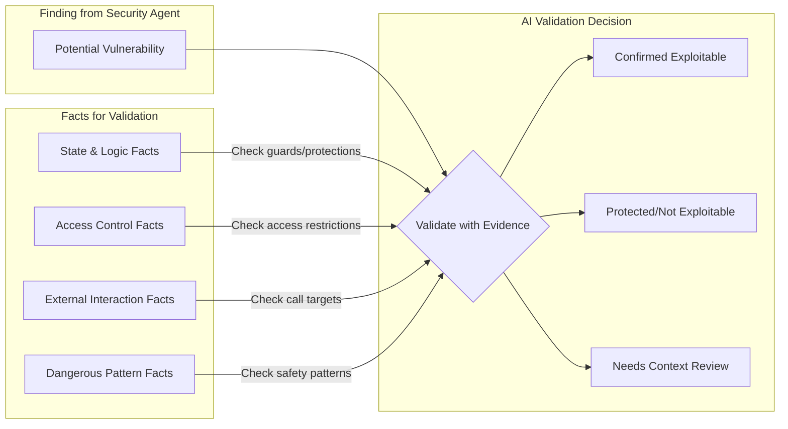
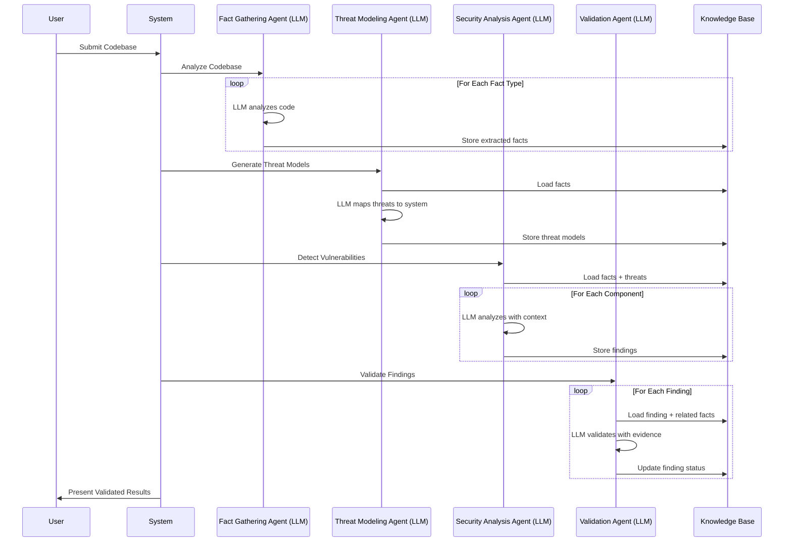
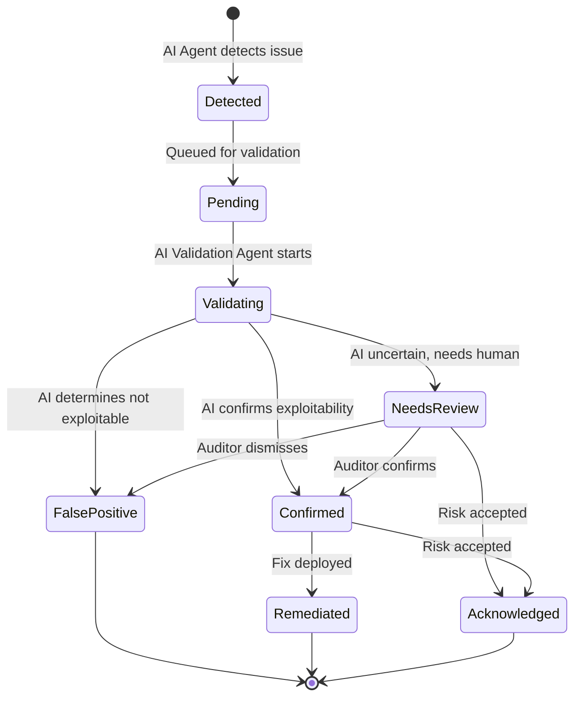

# AI-Powered Security Analysis System

An autonomous security analysis system built on Large Language Models (LLMs) and AI agents. Designed for analyzing any codebase with deep expertise in blockchain and decentralized systems.

---

## System Overview

---

## AI Agent Architecture

The system uses specialized LLM-powered agents for each phase of analysis:

### Agent Characteristics

| Agent | Purpose | LLM Role |
|-------|---------|----------|
| **Fact Gatherer** | Extracts structured knowledge from code | Understands code patterns, identifies security-relevant constructs |
| **Threat Modeler** | Applies relevant threat models | Maps attack vectors based on codebase type and architecture |
| **Security Analyzer** | Detects vulnerabilities using context | Combines code analysis with facts and threat models |
| **Validator** | Verifies findings with evidence | Cross-references findings against facts to reduce false positives |

---

## The Four Phases

### Phase 1: Fact Gathering
AI agents analyze the codebase to extract structured facts about architecture, attack surfaces, and security properties.

### Phase 2: Threat Modeling  
Using gathered facts, agents apply relevant threat models based on the codebase type and identified patterns.

### Phase 3: Vulnerability Detection
Security analysis agents scan the code using facts and threat models as context for accurate detection.

### Phase 4: Validation
Validation agents verify each finding against the facts knowledge base to confirm exploitability.

---

## Detailed Flow with Feedback Loops

---

## Fact Types

The AI agents gather 11 distinct types of facts about the codebase:

### 1. Architecture Facts
**Purpose:** Understand the system's structural design

| Aspect | Description |
|--------|-------------|
| Components | Main modules, services, contracts, and their responsibilities |
| Design Patterns | Architectural patterns used (proxy, factory, singleton, etc.) |
| Layers | Separation of concerns, component hierarchy |
| Trust Boundaries | Boundaries between trusted and untrusted components |
| Inter-Component Communication | How components interact with each other |

### 2. Attack Surface Facts
**Purpose:** Identify all entry points and exposed interfaces

| Aspect | Description |
|--------|-------------|
| Public Interfaces | Exposed functions, endpoints, APIs |
| User Inputs | All points where external input is accepted |
| Callback Handlers | Functions triggered by external events |
| Default Handlers | Fallback behaviors, catch-all handlers |
| Cross-System Entry | Entry points from external systems |

### 3. Dependency Facts
**Purpose:** Catalog external dependencies and libraries

| Aspect | Description |
|--------|-------------|
| Direct Dependencies | Libraries and packages directly used |
| External Systems | External protocols, services, systems |
| Interface Dependencies | Standards and interfaces implemented |
| Inherited Components | Base components and their properties |
| Version Information | Dependency versions for vulnerability matching |

### 4. Data/Asset Flow Facts
**Purpose:** Track how data and value move through the system

| Aspect | Description |
|--------|-------------|
| Value Transfers | Movement of assets, tokens, funds |
| Sensitive Data | PII, credentials, secrets locations |
| Accounting Logic | Balance tracking, state calculations |
| Fee Mechanisms | Protocol fees, charges, deductions |
| Flow Paths | Complete paths from source to sink |

### 5. Access Control Facts
**Purpose:** Document permission and authorization systems

| Aspect | Description |
|--------|-------------|
| Role System | Defined roles and their capabilities |
| Permission Checks | Where and how permissions are verified |
| Multi-Party Requirements | Multi-sig, threshold, consensus requirements |
| Emergency Controls | Pause mechanisms, circuit breakers |
| Privilege Management | How privileges are granted/revoked |

### 6. Dangerous Pattern Facts
**Purpose:** Identify potentially unsafe operations

| Aspect | Description |
|--------|-------------|
| Dynamic Execution | Dynamic code execution, eval, reflection |
| External Calls | Calls to untrusted external components |
| Low-Level Operations | Direct memory access, unsafe operations |
| Destructive Operations | Delete, destroy, irreversible actions |
| Unchecked Operations | Operations without safety checks |

### 7. Input Validation Facts
**Purpose:** Document input handling and sanitization

| Aspect | Description |
|--------|-------------|
| Validation Points | Where inputs are validated |
| Validation Rules | What checks are applied |
| Bounds Checking | Min/max limits, range validation |
| Format Validation | Type checks, format requirements |
| Signature Validation | Cryptographic signature verification |

### 8. Cryptography Facts
**Purpose:** Catalog cryptographic implementations

| Aspect | Description |
|--------|-------------|
| Algorithms Used | Encryption, hashing, signing algorithms |
| Key Management | Key generation, storage, rotation |
| Proof Systems | Merkle proofs, zero-knowledge, commitments |
| Randomness Sources | How randomness is generated |
| Signature Schemes | Digital signature implementations |

### 9. State & Business Logic Facts
**Purpose:** Understand application state and logic flows

| Aspect | Description |
|--------|-------------|
| State Variables | Critical state and their meaning |
| Invariants | Conditions that must always hold |
| State Transitions | Valid state changes, lifecycle |
| Business Rules | Core logic constraints and rules |
| Concurrency Patterns | Reentrancy guards, mutex, locks |

### 10. External Interaction Facts
**Purpose:** Map all external system dependencies

| Aspect | Description |
|--------|-------------|
| External Data Sources | Oracles, APIs, data feeds |
| Protocol Integrations | Third-party protocol interactions |
| Cross-System Communication | Messages, events, callbacks |
| External Services | Cloud services, infrastructure dependencies |
| Trust Assumptions | What external systems are trusted |

### 11. Threat Indicator Facts
**Purpose:** Identify patterns suggesting security concerns

| Aspect | Description |
|--------|-------------|
| Vulnerability Patterns | Code patterns matching known vulnerabilities |
| Manipulation Vectors | Patterns susceptible to manipulation |
| Centralization Risks | Single points of failure |
| Front-Running Risk | Operations vulnerable to ordering attacks |
| Configuration Issues | Insecure defaults, misconfigurations |

---

## Threat Categories

---

## Feedback Loop 1: Facts → Threat Modeling

**How AI Uses Facts for Threat Modeling:**

| Fact Type | AI Agent Application |
|-----------|---------------------|
| Architecture | Identifies system type → selects relevant threat models |
| Attack Surface | Maps all entry points for enumeration of attack vectors |
| External Interactions | Dependencies → adds manipulation/trust threats |
| Data/Asset Flow | Value patterns → enables drain attack modeling |
| Access Control | Privileged functions → adds escalation scenarios |

---

## Feedback Loop 2: Facts → Finding Validation

**How AI Uses Facts for Validation:**

| Fact Type | AI Validation Application |
|-----------|--------------------------|
| State & Logic | Checks if protection mechanisms exist |
| Access Control | Verifies if vulnerable function is actually callable |
| Data/Asset Flow | Confirms if value can actually be extracted |
| Dangerous Patterns | Cross-references with known safe patterns |
| Input Validation | Checks if attack inputs would pass validation |

---

## AI Agent Interaction Flow

---

## Finding Lifecycle

---

## Process Summary

| Phase | AI Agent Role | Input | Output |
|-------|---------------|-------|--------|
| **Fact Gathering** | LLM extracts structured knowledge from code | Codebase | 11 Fact Types |
| **Threat Modeling** | LLM maps relevant threats to system | Facts + Threat Library | Active Threats |
| **Security Analysis** | LLM detects vulnerabilities with full context | Code + Facts + Threats | Findings |
| **Validation** | LLM verifies exploitability using facts as evidence | Findings + Facts | Validated Results |

---

## Key Principles

1. **LLM-Powered Analysis** — All phases use Large Language Models that understand code patterns and security concepts

2. **Facts as Context** — The facts knowledge base provides rich context that enables more accurate AI analysis

3. **Threat Model Flexibility** — Threat models are selected based on codebase type and identified patterns

4. **AI Agent Autonomy** — Each agent operates autonomously with specialized tools for their specific task

5. **Evidence-Based Validation** — The validation agent cross-references findings against facts, reducing false positives through AI reasoning

6. **Iterative Improvement** — Agents can re-analyze as code is updated, maintaining accurate knowledge base
